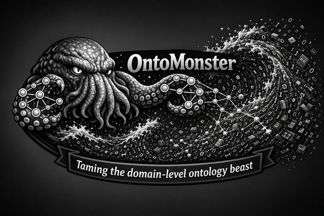

<div align="center">
  
  
  # OntoMonster
</div>

OntoMonster bridges the gap for non-ontologists to build ontologies for their specific domains. By relying on BFO-aligned ontologies (CCO, IOF, QUDT, OBO), it maximizes interoperability while remaining domain-agnostic. Everything runs locally on your computer—no server account or database needed.

OntoMonster supports the [FAIR principles](https://www.go-fair.org/fair-principles/) (Findable, Accessible, Interoperable, Reusable) for data management with built-in data provenance tracking.

**Key features:**
- Import structured data (CSV, Excel, XML, JSON, Parquet, HuggingFace datasets)
- Automatically establish predicates and subclass relationships
- Visualize and interact with your ontology
- Organize by project workspaces
- Export to multiple formats (OWL, LinkML, SHACL)
- Match terms to standard ontologies with autofill

## Prerequisites

- **Python 3.8+** (tested on Python 3.8, 3.9, 3.10, 3.11)
- **pip** for package installation
- **Modern web browser** (Chrome, Firefox, Safari, Edge)

## Getting Started

### Installation

1. Clone the repository:
```bash
git clone https://github.com/Jay2-davic/ontomonster.git
cd ontomonster
```

2. Install OntoMonster (choose one method):

**Option A: Using pip**
```bash
# Step 1: Install OntoMonster
pip install -e .

# Step 2: Run OntoMonster (browser opens automatically)
ontomonster
```

**Option B: Using Pixi (recommended for reproducible environments)**
```bash
# Install Pixi: https://pixi.sh/latest/#installation
curl -fsSL https://pixi.sh/install.sh | bash  # Linux/macOS
# or: iwr -useb https://pixi.sh/install.ps1 | iex  # Windows

# Step 1: Install dependencies
pixi install

# Step 2: Run OntoMonster (browser opens automatically)
ontomonster
```

3. Your browser opens automatically to http://127.0.0.1:8000

**Command options:**
```bash
ontomonster --port 8001        # Use different port
ontomonster --no-browser       # Don't open browser automatically
```

### First Steps

At startup, you'll choose between:
- **Load existing**: Point to your Reference Ontology Location (input) and Internal Ontology Location (output)
- **Start a new project**: OntoMonster creates the folder structure for you

See the [User Guide](docs/GUIDE.md) for a complete walkthrough with screenshots.

## How It Works

OntoMonster works with two folders:

- **Reference Ontology Location (input)**: Your library of standard ontologies (BFO, CCO, IOF, QUDT, OBO, etc.) loaded for autofill and the Glossary
- **Internal Ontology Location (output)**: Where your ontologies are built, organized by org and workspace

### Workflow

1. Select an org and workspace
2. Author terms with autofill from loaded reference ontologies
3. Visualize your ontology in an interactive graph
4. Run **Scan** to find consistency issues
5. **Export** to OWL (`.ttl`, `.rdf`, `.jsonld`), LinkML (`.yaml`), and SHACL (`.shacl.ttl`)

See [template-structure/](template-structure/) for example folder organization.

## Features

### Authoring
- Standard terms in your own namespace with definitions and live checks
- Autofill matching against mid-level ontologies with autocomplete
- Term inspector: category (subclass-of vs type), label, definition, relationships

### Data Import
- Import from CSV, TSV, Excel (.xlsx), XML, JSON, Parquet, HuggingFace dataset cards
- Inspect & label workflow for spreadsheets
- Block mode and Link mode for cell marking
- Structure options: subclass hierarchy, grouping classes, field-as-term

### Quality & Export
- **Scan** for orphans, empty fields, broken/fabricated references, datatype mismatches, duplicates, class/individual conflicts, missing OWL types
- **Export** with format selection: OWL, LinkML, SHACL
- Per-workspace exports and org-level consolidation bundle
- ISO/IEC 21838-1 aligned, LinkML-validated

### Visualization
- Interactive Focus/Bloom graph views
- Hierarchy/Star layouts
- Zoomable map with filtering by predicate
- Size, spacing, edge controls, and maximize mode

### Reference Ontologies
- Searchable **Glossary** of loaded ontologies grouped by subject domain
- Browse terms, alternative labels, URIs, and definitions
- Color-coded, collapsible domain groups

## Built With

- **[FastAPI](https://fastapi.tiangolo.com/)** - Web framework
- **[RDFLib](https://rdflib.readthedocs.io/)** - RDF graph manipulation
- **[LinkML](https://linkml.io/)** - Schema modeling and validation
- **[Playwright](https://playwright.dev/)** - UI testing and documentation screenshots
- **Vanilla JavaScript** - Single-page UI (no framework dependencies)

## Documentation

- [User Guide](docs/GUIDE.md) - Step-by-step walkthrough with screenshots
- [Usage](docs/usage.md) - Quick reference
- [Architecture](docs/architecture.md) - Design philosophy and capabilities
- [Data Model](docs/data-model.md) - Folder structure and organization
- [Changelog](CHANGELOG.md) - Version history
- [Credits](CREDITS.md) - Acknowledgments and citations

## Contributing

We welcome contributions! Please read our [Contributing Guidelines](CONTRIBUTING.md) for details on:
- Code of Conduct
- Development workflow
- Coding standards
- How to submit pull requests

**Quick start:**
1. Fork the repository
2. Create a feature branch
3. Make your changes following our [style guidelines](CONTRIBUTING.md#code-style)
4. Submit a pull request

All contributions must be made under the BSD-3-Clause license. See [CONTRIBUTING.md](CONTRIBUTING.md) for full details.

## Versioning

This project uses [Semantic Versioning](https://semver.org/). For available versions, see the [releases page](https://github.com/Jay2-davic/ontomonster/releases).

**Current version: 1.0.0**

## Authors

**J.C. Jimenez** - Author

See the [contributors list](https://github.com/Jay2-davic/ontomonster/graphs/contributors) for all who have participated in this project.

## License

This project is licensed under the BSD-3-Clause License - see the [LICENSE](LICENSE) file for details.

```
Copyright 2024-2025 Lawrence Livermore National Security, LLC and OntoMonster contributors.

SPDX-License-Identifier: BSD-3-Clause
```

**LLNL Release Number:** LLNL-CODE-2026540

## Author

**J.C. Jimenez**  
Author - Conceptualization, design, and architecture

**SI Disclosure:**  
Super Intelligence (SI) tools were used to aid in coding and accelerate prototyping.

## Acknowledgments

**Citations:**
- [CEMENTO: A Common Metadata Notation Ontology](https://cwru-sdle.github.io/CEMENTO/index.html)
- [BFO (Basic Formal Ontology)](https://basic-formal-ontology.org/) - Upper-level ontology framework
- Compatible with any BFO-aligned mid/low-level ontologies (CCO, IOF, QUDT, OBO, etc.)
