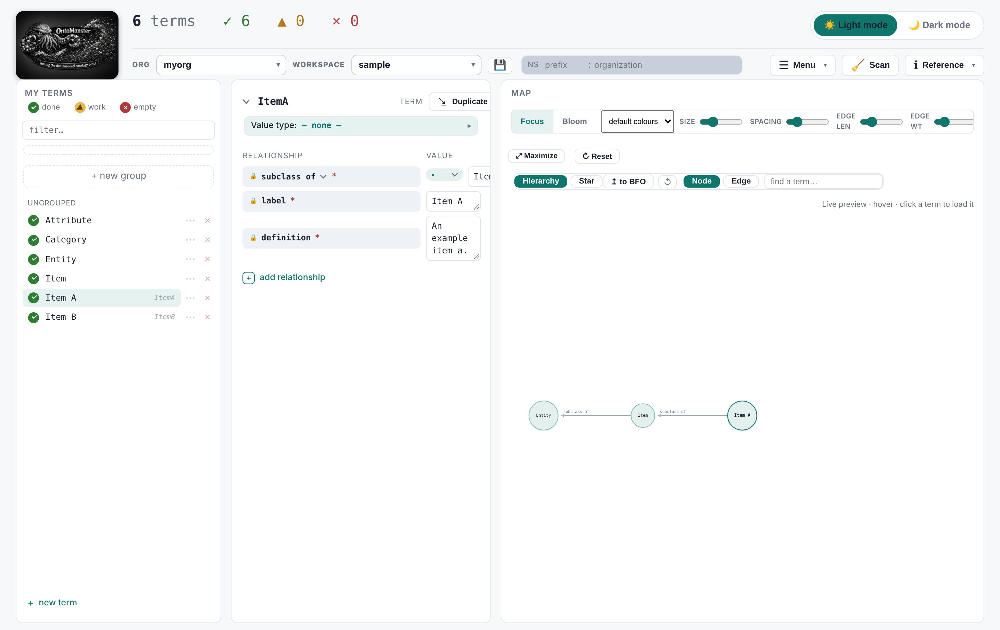

# Architecture

## What OntoMonster Does

OntoMonster bridges the gap for non-ontologists to build ontologies for their specific domains.

### Key Capabilities

1. **Domain-agnostic standardization**: Relies on BFO-aligned ontologies (CCO, IOF, QUDT, OBO) to maximize interoperability across domains.

2. **Import structured data**: Upload files in multiple formats—CSV, TSV, Excel (`.xlsx`), XML, JSON, Parquet, and HuggingFace dataset cards. OntoMonster pre-fills terms and automatically establishes CCO predicates and subclass relationships based on the data structure.

3. **Handle unstructured data**: For messy Excel files, specify how individual data chunks are structured so the app can parse them correctly.

4. **Build and grow your terms**: Save drafts as you work. Terms accumulate over time, building a reusable vocabulary for your organization.

5. **Visualize and interact**: Explore your ontology with interactive graphs, filter by predicates, and see how terms connect.

6. **Organize by project**: Keep ontologies manageable with workspace-level organization that aggregates to the org level. Each workspace can represent a different project or domain.

7. **Specify datatypes easily**: Define what values should be (strings, integers, dates, etc.), which is essential for tabular data imports.

8. **Match to existing ontologies**: Build metadata and attributes, then easily match them to standard ontologies through autofill.

9. **Export in multiple formats**: Generate OWL (Turtle, RDF/XML, JSON-LD), LinkML (YAML), and SHACL shapes from your ontologies.

10. **Import compatible ontologies**: Bring in existing OWL/RDF ontologies to extend or reference in your work.

### How It Works

OntoMonster is a local web app that runs entirely on your computer. No data leaves your machine, and no server account is needed.

The app uses two folders that you specify:

- **Reference Ontology Location (input)**: Your library of standard ontologies (BFO, CCO, IOF, QUDT, OBO, etc.)
- **Internal Ontology Location (output)**: Where your ontologies are organized by **org** and **workspace**

## What happens at load

1. **Load** sets the two locations and opens the Internal Ontology Location.
2. The app builds or checks the reference cache from the Reference Ontology
   Location. A progress overlay shows.
3. When you select an **Org**, the app loads only the workspaces of that org:
   the drafts from `<org>/save/` and the committed `.ttl` files. Orgs never
   mix.
4. Edits stay in memory. A **save** writes to `<org>/save/`. An **export**
   writes the files.

See the [User Guide](GUIDE.md) for the task-level description with figures.
