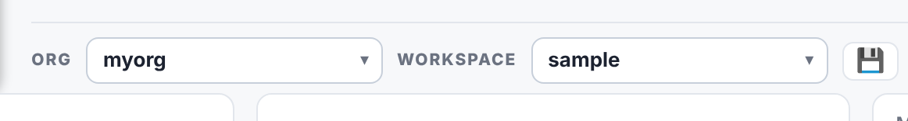

# Data model

## Internal Ontology Location (output)

This folder holds the ontologies that you build. They are organized by **org**
and then by **workspace**. There is no `project.toml` file.

```
<internal-ontology>/
  <org>/                          for example: myorg/
    <org>_workspace/              the workspaces, as flat files
      <workspace>.ttl             the source file of a workspace
      <workspace>.rdf             the other formats of the export
      <workspace>.jsonld
      <workspace>.yaml
      <workspace>.shacl.ttl
    <org>_consolidate/            the union of the workspaces of the org
      <org>_consolidate.*         the same five formats
    save/                         drafts and versions
```

See [template-structure/](../template-structure/) for a concrete example.



## Terms

A workspace is a list of terms. Each term has:

- a **name**. The app removes the own-namespace prefix at load.
- a category: `subclass of` or `type`.
- **relationships**: a predicate and a value.

References to loaded ontologies resolve to real URIs. Own terms serialize as
`:term`. The namespace stays blank until you set it.

## Save and export

- A **save** writes a working draft to `<org>/save/`. It writes no ontology
  files and creates no version.
- An **export** creates a version (1, 2, 3 and so on) in `<org>/save/`. It
  writes the five files to `<org>_workspace/` and updates
  `<org>_consolidate/`. If a reference does not resolve, the export stops and
  shows the problems.

## Reference Ontology Location (input)

This folder holds the standard ontologies you want to reference (BFO, CCO, IOF, QUDT, OBO, etc.). The app reads the prefixes and namespaces from each file and uses them for autofill and the Glossary.
