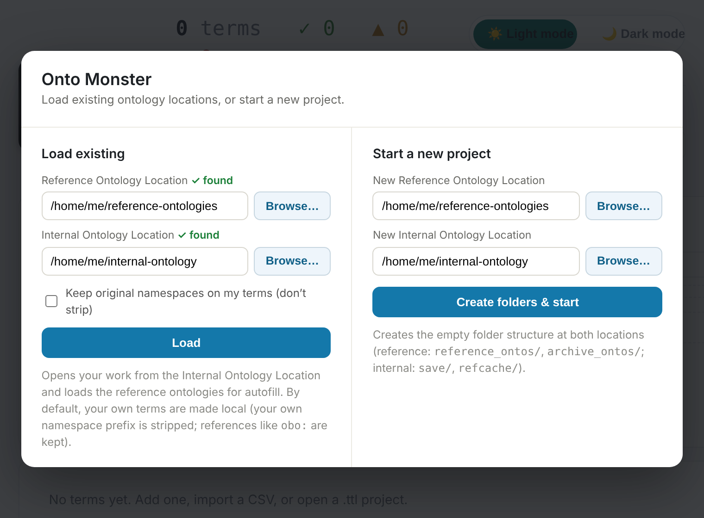
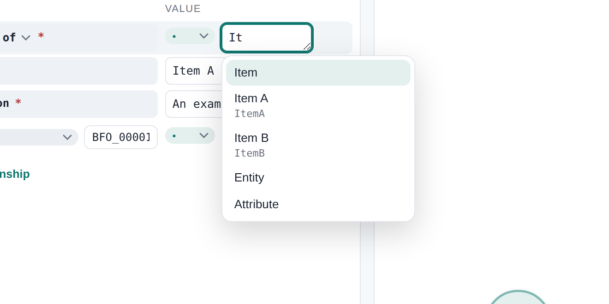
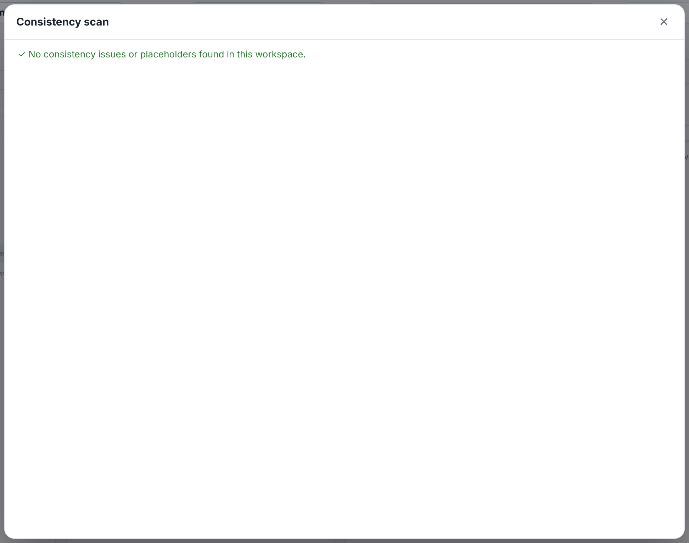
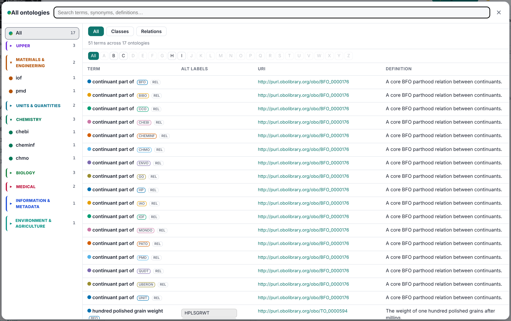
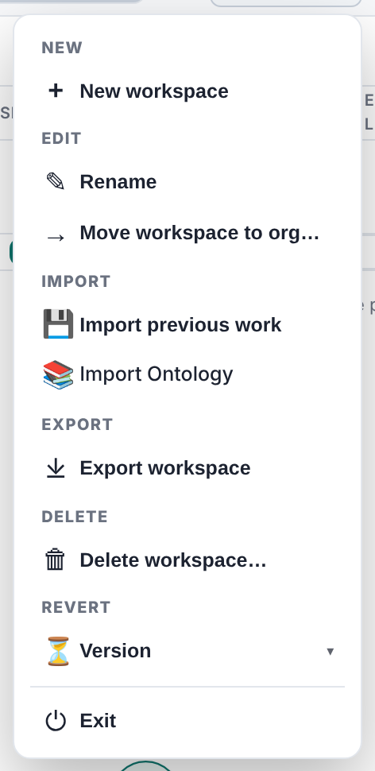

# Usage

## Install and run

**Method 1: Using pip**
```bash
# Install OntoMonster
pip install -e .

# Run OntoMonster (browser opens automatically)
ontomonster
```

**Method 2: Using Pixi**
```bash
# Install dependencies
pixi install

# Run OntoMonster (browser opens automatically)
ontomonster
```

**Command options:**
```bash
ontomonster --port 8001        # Use different port
ontomonster --no-browser       # Don't open browser
```

The browser opens automatically to http://127.0.0.1:8000.

## Work flow

1. Select **Load existing**. Give a Reference Ontology Location (input) and an
   Internal Ontology Location (output). Or select **Start a new project** to
   create the folder structure.

   

2. Select an **Org**. Then select a **Workspace**, or create one. When you
   change the org, the app loads only the workspaces of that org.

3. **Write** terms in the inspector: the category, the label, the definition
   and the relationships. Use the **autofill** to match values against all
   loaded reference ontologies.
   
   Optionally, select **Menu > Import > Import data...** to bring in terms from a file (CSV, Excel, XML, JSON, Parquet, or data cards). See [Bring in your data](GUIDE.md#4-bring-in-your-data) for details.

   

4. Run **Scan**. It finds orphans, empty fields, broken or invented
   references, datatype mismatches, duplicates, conflicts and missing OWL
   types.

   

5. Run **Export**. The app writes the five files to the `<org>_workspace/`
   folder and updates the `<org>_consolidate/` bundle of the org. If a
   reference does not resolve, the export stops and shows a list of problems.

6. Select **Reference > Glossary** to browse the loaded ontologies. They are
   grouped by subject domain.

   

The menu has these groups: **New**, **Edit**, **Import**, **Export**,
**Delete**, **Revert** and **Exit**.



For the full description, read the [User Guide](GUIDE.md).
